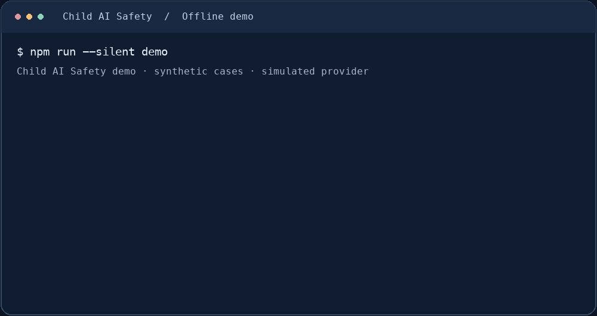
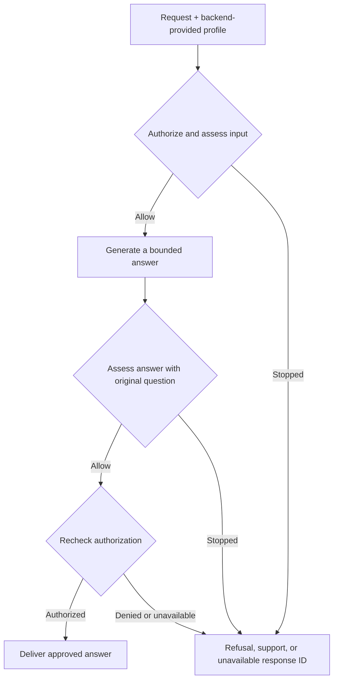

# SamSquare Child AI Safety

An open-source TypeScript gateway and evaluation toolkit for developers building AI features for children. It checks requests and generated answers before delivery and provides an offline way to test how the app handles refusals, support responses, and detector outages.

[](https://github.com/SamSquareAI/child-ai-safety/actions/workflows/ci.yml)
[](LICENSE)
[](docs/DEVELOPER_PREVIEW.md)

**Developer preview.** The gateway requires an application-supplied authorization policy, detector, and generator. Production qualification is tracked in the [release checklist](docs/RELEASE_CHECKLIST.md).

## Try it locally

Use Node.js 22 or later. The demo uses synthetic fixtures and simulated providers, so it runs without API keys.

```sh
git clone https://github.com/SamSquareAI/child-ai-safety.git
cd child-ai-safety
npm ci --ignore-scripts
npm run --silent demo
```



[Read the demo and rehearsal guide](docs/DEVELOPER_PREVIEW.md)

## How a request flows



The gateway buffers answers until the checks finish. Local checks run before remote assessment, and malformed or unavailable assessment results block generated delivery. For other outcomes, the app maps a response ID to its own static copy. See the [protocol](docs/PROTOCOL.md) and [delivery contract](docs/DELIVERY.md).

## What you can test today

| Coverage | What it exercises |
| --- | --- |
| **144 scripted cases** | The [offline scope matrix](docs/SCOPE_MATRIX.md) checks gateway routing across 4 age profiles and 3 languages with simulated adapters. |
| **English, French, Spanish** | The [draft response catalog](docs/RESPONSE_CATALOG_REVIEW.md) and synthetic fixtures cover refusals, support, and unavailable responses. |
| **6 session boundary checks** | The [loopback rehearsal](docs/SESSION_BOUNDARY_REHEARSAL.md) covers session replacement, revocation, isolation, and policy rollback. |

These checks measure behavior against scripted expectations. See the [evaluation guide](docs/EVALUATION.md) for reporting methods and the [engineering status](docs/ENGINEERING_STATUS.md) for live synthetic experiments.

## Build or contribute

- **Integrate a detector.** Start with the [adapter contract](docs/DETECTOR_ADAPTER.md) and the [reference HTTP service](docs/REFERENCE_SERVICE.md).
- **Run the checks.** Use `npm run preview:check` for contract tests, adapter conformance, and offline rehearsals.
- **Make a first contribution.** Look for a [good first issue](https://github.com/SamSquareAI/child-ai-safety/labels/good%20first%20issue) or propose a synthetic test, translation, or documentation improvement. See the [contribution guide](CONTRIBUTING.md).

[Roadmap](docs/NEXT_PHASE_PLAN.md) · [Threat model](docs/THREAT_MODEL.md) · [Report a vulnerability privately](SECURITY.md) · [Apache 2.0 license](LICENSE)
