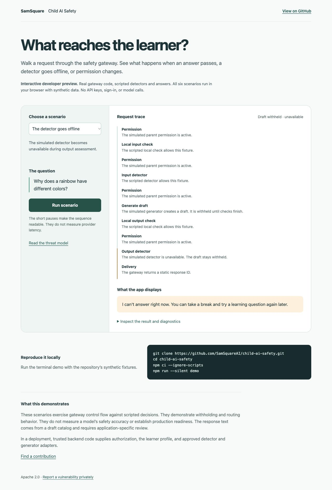
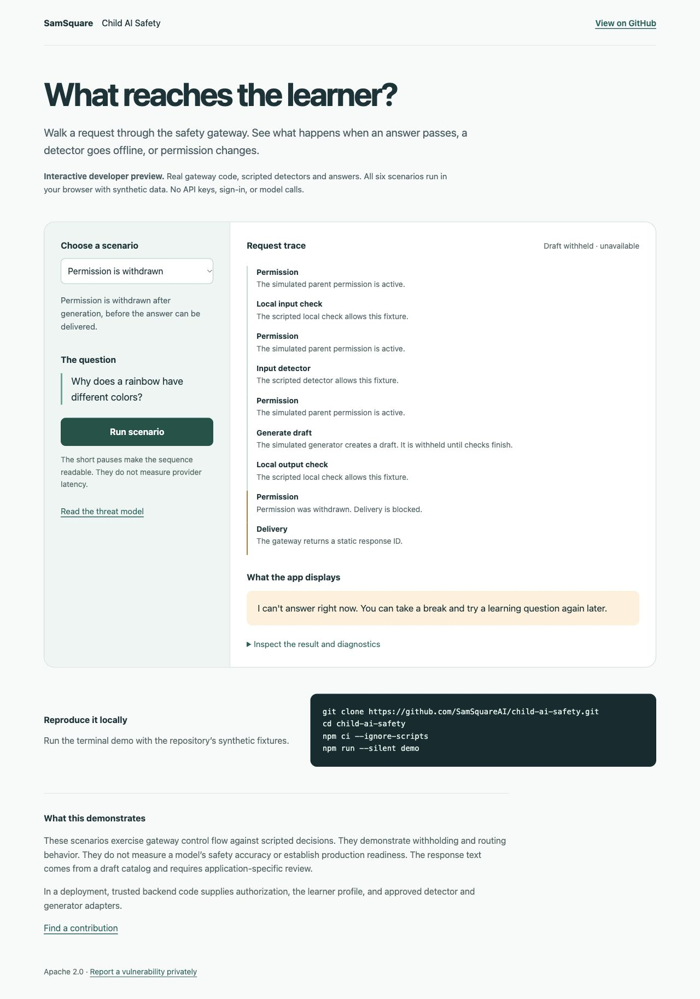
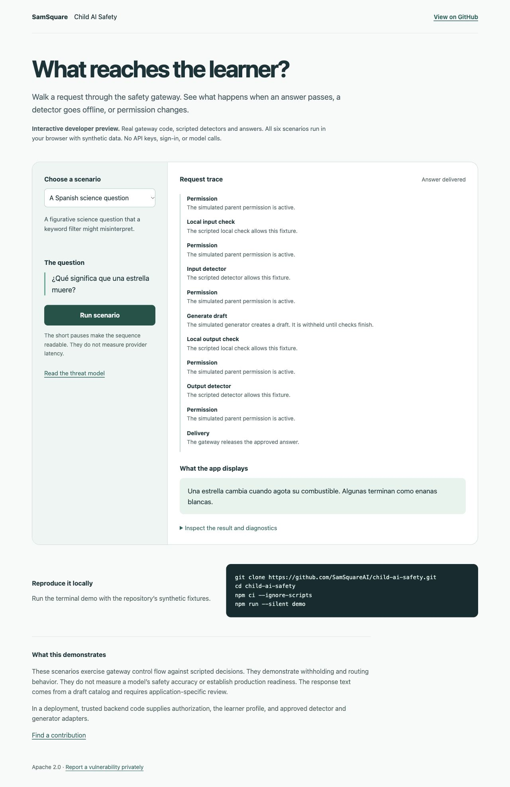

# Interactive browser demo

[Open the demo](https://samsquareai.github.io/child-ai-safety/).

Six fixed synthetic scenarios run through the TypeScript gateway in your browser.
The detector decisions and generated answers are scripted. Use the request trace,
app-facing response, and expandable diagnostics to inspect delivery behavior.

| Scenario | What to inspect |
| --- | --- |
| A learning question | The approved answer is released after the checks and final authorization. |
| The detector goes offline | Generation runs, but an unavailable output assessment withholds the answer. |
| Permission is withdrawn | Authorization fails after generation. The candidate is withheld. |
| A request for private details | The scripted input refusal prevents generation. |
| A French science question | A benign educational question is allowed by the scripted detector. |
| A Spanish science question | Figurative wording about a star dying is allowed by the scripted detector. |

The French and Spanish examples illustrate candidate overblocking test cases.
They do not establish the accuracy of a deployed detector. The app-facing static
responses use the draft catalog, which requires review before deployment.

## Three short walkthroughs

### An outage after generation

Select **The detector goes offline**, then **Run scenario**. The trace shows a
draft being generated and withheld after the unavailable output assessment.
The result has an unavailable response ID and no generated text. Expand the
result to see the detector-unavailable diagnostic and one generator call.

### Permission withdrawn before delivery

Select **Permission is withdrawn**, then **Run scenario**. The fixture withdraws
permission immediately after generation. The next authorization check stops the
request. Inspect the unavailable result and authorization-denied diagnostic.

### Benign Spanish learning content

Select **A Spanish science question**, then **Run scenario**. The scripted
assessment allows a question about what it means for a star to die. The gateway
releases the Spanish educational answer. This is a reproducible fixture for
conversations about overblocking; a real detector needs separate evaluation.

## Local development

Run `npm ci --ignore-scripts`, `npm run demo:build`, then serve `site/` using a
static server. `npm run preview:check` includes the six scenario contract tests.
The browser build precompiles schema validators and bundles the gateway and
fixtures. Its content security policy blocks outgoing connections and runtime
code generation. The page uses no analytics, storage, free-text submissions,
provider calls, or API keys. Hosting providers still receive ordinary HTTP
requests when the page and assets are loaded.

The pauses between displayed steps exist for readability. They are not model
latency measurements. Changes to gateway or validator behavior should be checked
in both the Node test suite and the bundled browser demo.
