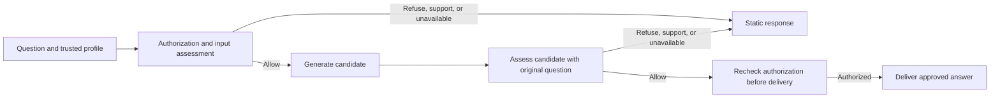

# Child AI Safety developer preview

SamSquare Child AI Safety is an open-source TypeScript gateway and evaluation toolkit for age-aware educational AI. The preview gives developers a way to exercise input and output assessment, consent boundaries, and localized response routing with synthetic data.

## Try it locally

From the repository root, with Node.js 22 or later:

```sh
npm ci --ignore-scripts
npm run --silent demo
```

The demo asks why a rainbow has different colors, shows the approved example answer, then displays draft responses for a refusal, a support case, and a simulated detector outage. It uses synthetic fixtures and needs no API key.

The gateway takes a trusted profile and checks authorization before it can send
content to the detector or generator. The output check receives the original
question alongside the candidate answer.



## Read and compare a rehearsal

```sh
npm run --silent eval:rehearsal > current.json
npm run --silent eval:report -- current.json
npm run --silent eval:report -- baseline.json current.json
```

The rehearsal verifies the pinned fixtures and draft response catalog, scores
the local precheck, and checks delivery with simulated detector and generator
responses. The Markdown report gives planned counts and draft matches by
language, age band, and stage, with a separate table for normal and outage
delivery. It includes failed and missing assessments. Changed counts appear as
baseline → current. Comparisons require matching corpus, contextual assessment
subset, catalog, and fixture configuration digests. The fixture configuration
digest binds the simulation settings. Record the source revision separately
when comparing implementations.

## Contribute

- Improve English, French, or Spanish wording and document regional or age-specific differences with invented examples.
- Add benign educational cases that exercise false refusals and show the intended behavior.
- Improve adapter examples or tooling for collecting content-free results from local evaluations.

Start with the contribution guide and open a focused issue or pull request. Use private reporting for vulnerability details. [Contribution guide](../CONTRIBUTING.md) · [Security policy](../SECURITY.md)

## Deployment status

This source preview supports local evaluation and integration development. A child-facing deployment still needs a qualified detector and provider configuration, verified consent and delivery on the deployed application, operational testing, and a tested rollback. The current repository records production evidence separately. [Next-phase plan](NEXT_PHASE_PLAN.md) · [Release checklist](RELEASE_CHECKLIST.md)
